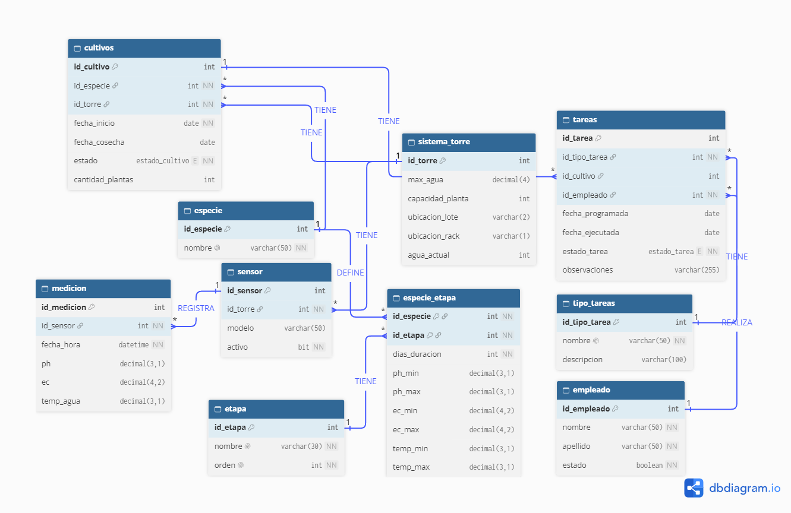

# 🌱 Sistema de Gestión Hidropónica — Trabajo Práctico SQL - GRUPO 7

Trabajo práctico de base de datos que modela la gestión de un sistema de cultivo hidropónico. El proyecto está desarrollado íntegramente en **SQL**, incluyendo el diseño de entidades, triggers, stored proceduresy vistas.

> ⚠️ Proyecto en desarrollo: la estructura y el contenido de este README se irán actualizando a medida que avance el trabajo.

## 📋 Índice

- [Contexto](#-contexto)
- [Tecnologías](#-tecnologías)
- [Estructura del repositorio](#-estructura-del-repositorio)
- [Modelo de datos](#-modelo-de-datos)
- [Triggers](#-triggers)
- [Stored Procedures](#-stored-procedures)
- [Instalación y ejecución](#-instalación-y-ejecución)
- [Ejemplos de uso](#-ejemplos-de-uso)
- [Integrantes](#-integrantes)

## Contexto

La hidroponía es una técnica de cultivo sin suelo en la que las plantas crecen con sus raíces en una solución de agua y nutrientes, dentro de un ambiente controlado como un invernadero, para que el cultivo prospere, es necesario mantener estables una serie de parámetros ambientales, proveer sales de nutrición a las plantas y llevar un seguimiento detallado de cada etapa de la planta.

## Problemática

A partir del relevamiento realizado con una persona que gestiona un cultivo, se identificó que actualmente los invernaderos son administrados mediante tareas manuales. Las personas a cargo deben controlar de forma periódica parámetros como el nivel de agua, el tiempo de cosecha y los mantenimientos de cada sistema NFT. Toda la información del cultivo se asienta en un cuaderno. Este método resulta rutinario y poco eficiente: depende de la constancia de quien registra, dificulta detectar a tiempo valores fuera de lo normal, no permite consultar el historial de forma ágil y el cultivo queda expuesto al error humano.

## Propuesta

Este trabajo práctico propone el diseño de una base de datos para un sistema de gestión de invernadero que permita:
Automatizar el control de parámetros mediante sensores que registren las mediciones de temperatura, humedad, nutrientes y nivel de agua.
Generar alertas cuando algún parámetro se encuentre fuera del rango configurado.
Reemplazar el registro en cuaderno por tablas que almacenen la información de cada planta y sistema: fase, fecha de plantación, fecha de cosecha y tiempo de curado.
Gestionar a los empleados y las tareas que realizan, como poda, cosecha, corrección de pH y mantenimiento ante fallas de sensores o equipos.

**Materia:** _[Ingeniería de Datos I]_
**Institución:** _[UADE]_
**Año / Cuatrimestre:** _[2026 – 2° cuatrimestre]_

## 🛠 Tecnologías

- **Motor de base de datos:** SQL Server
- **Herramienta de gestión:** SSMS

## 📁 Estructura del repositorio

```
.
├── README.md
├── 1-. Creacion de BD y Tablas.sql   # Creación de la base, tablas y restricciones
├── 2-. Inserts de datos.sql          # Datos de prueba
├── 3-. Funciones.sql                 # Funciones definidas por el usuario
├── 4-. Vistas.sql                    # Vistas
├── 5-. Stored Procedures.sql         # Stored procedures
├── 6-. Triggers.sql                  # Triggers
├── 7-. Seguridad.sql                 # Usuarios, roles y permisos
├── 8-. Consultas.sql                 # Consultas SQL
├── 9-. Subconsultas.sql              # Consultas con subconsultas
└── docs/
    └── DER.png                       # Diagrama entidad-relación
```

Los scripts están numerados según el orden en que deben ejecutarse: cada uno depende de los objetos creados por los anteriores.

> La estructura es tentativa y puede cambiar.

## 🗂 Modelo de datos

### Entidades principales 

| Entidad         | Descripción                                                                                                             |
| --------------- | ----------------------------------------------------------------------------------------------------------------------- |
| `Especie`       | Tipo de planta cultivada (lechuga, albahaca, tomate, etc.) y sus parámetros ideales.                                    |
| `Sistema_Torre` | Cada torre pose parametros como ubicacion y agua, donde se cultivaran las plantas                                       |
| `Cultivos`      | Siembra concreta de una especie en un sistema, con fechas de inicio y estado.                                           |
| `Tareas`        | Tareas que se deben realizar en base a los estados de las torres hidroponicas                                           |
| `Tipo_tareas`   | Descripción de cada tarea que se debe realizar                                                                          |
| `Sensor`        | Para medir los valores de las torres, se deben colocar sensores que registran las mediciones. Cada torre tiene sensores |
| `Etapa`         | Descripcion de las etapas que atraviesa un cultivo                                                                      |
| `Especie_etapa` | Se registra la etapa de cada especie con el valor de sus nutrientes                                                     |
| `Medicion`      | Valores obtenidos de cada sensor                                                                                        |
| `Empleado`      | Persona responsable de las tareas de mantenimiento.                                                                     |

### Diagrama Entidad-Relación




## 🚀 Instalación y ejecución

1. Clonar el repositorio:

```bash
git clone https://github.com/Zoale/happy_hydro_db.git
```

2. Abrir los scripts en _[SSMS]_.
3. Ejecutarlos **en orden numérico**, del `1-.` al `9-.`.

## 💡 Ejemplos de uso

```sql
-- Ejemplo: registrar un nuevo cultivo
EXEC SP_RegistrarCultivo @id_especie = 1, @id_torre = 1, @cantidad_plantas = 15;

-- Ejemplo: consultar cultivos activos
SELECT * FROM cultivos WHERE estado = 'EN PROGRESO';
```

> Los ejemplos se actualizarán según la implementación final.


Trello

```bash
https://trello.com/b/atc55BkM/tp-ing-datos-i
```

## 👥 Integrantes

| Integrantes — Grupo 7  |
| ---------------------- |
| Alejandro Zoilo Guzman |
| Diego Rua              |
| Macarena Molina        |
| Nicolas Puegher        |
| Guido Botta            |

## 📄 Licencia

Proyecto con fines académicos.
